<div align="center">


<p>
  <a href="https://github.com/NelsonFodjo/sideline/actions/workflows/ci.yml"></a>
  <a href="https://github.com/NelsonFodjo/sideline/actions/workflows/codeql.yml"></a>
  <a href="LICENSE"></a>
  
  
  
  
  
  <a href="CONTRIBUTING.md"></a>
</p>

<p>
  <a href="https://sideline-1cri.onrender.com/"></a>
  <a href="https://sideline-1cri.onrender.com/mcp"></a>
  
  
  
</p>


<p><b><a href="#quick-start">Quick start</a> · <a href="#see-it">See it</a> · <a href="#how-it-works">How it works</a> · <a href="#the-tools">The tools</a> · <a href="#connect-it-to-anything-and-host-it-later">Host it</a> · <a href="#what-has-been-verified">What is verified</a> · <a href="#the-potential">The potential</a> · <a href="#known-limitations">Limits</a> · <a href="#contributing">Contribute</a></b></p>

</div>

---

> [!IMPORTANT]
> **The web page in this repository is a simulated Alexa+.** Alexa+ is the voice assistant that would talk to this server,
> and its add-on tooling is partner-only, so participants cannot connect the real one. The simulator plays that part
> honestly: it listens, chooses tools, calls them over MCP exactly as an external client would, and speaks the answer. It is
> a stand-in for Alexa+, not Alexa+, and it is how you run and judge everything below.

<a name="the-problem"></a>

## 🎧 The problem

You want the score. So you stop what you are doing, unlock your phone, open an app, search, scroll. **Or you just ask.**

For someone who cannot see a screen, asking is not a shortcut: it is the only way in. A broadcast is a picture with an audio
track attached. The line-ups are a graphic shown once and never read aloud; the score and the clock sit in a corner; the
booking, the substitution, the VAR decision are on screen and rarely spoken. A blind fan watching with a friend turns and
asks. Alone, there is nobody to ask.

**Sideline is that friend.** A self-hosted [MCP](https://modelcontextprotocol.io) server that answers a listener's questions
about live and recent sport, built for the Alexa+ track of the *Build, Ship, Shape: Amazon Developer Hackathon*. It reads
ESPN's public data (football, basketball, American football, hockey and baseball), remembers what each listener has already
heard, holds back anything their delayed stream has not shown yet, and speaks through Amazon Bedrock and Polly. The
[WHO](https://www.who.int/news-room/fact-sheets/detail/blindness-and-visual-impairment) estimates that at least 2.2 billion
people live with a near or distance vision impairment; they are who it is built for first. The same help suits anyone whose
hands or eyes are busy: driving, cooking, in a meeting, or late to the match.

<a name="at-a-glance"></a>

## ✨ At a glance

<table>
<tr>
<td width="50%" valign="top">
<p><b>🧠 It remembers you</b><br> One marker per listener (<code>last_told_at</code>), so "what did I miss?" needs no time range and never repeats itself.</p>
<p><b>🙈 It never spoils</b><br> Say your stream is behind and every event your picture has not reached is held back, by the clock.</p>
<p><b>🗣️ It says what it does not know</b><br> Every fact comes from a tool, never a model's memory. No referee in the feed? It says so.</p>
</td>
<td width="50%" valign="top">
<p><b>🏟️ Five sports, one set of tools</b><br> Football (about 220 competitions), basketball, American football, hockey and baseball. The clock speaks each sport's words.</p>
<p><b>⚡ Built for speed</b><br> Live data cached for seconds; a question after the first takes 0 to 3 s; standard-library Python, no install.</p>
<p><b>🔍 Every answer is traceable</b><br> The Dev log shows which tool ran, with which arguments, how long it took and how many feed requests it made.</p>
</td>
</tr>
</table>

| | |
|---|---|
| **What it is** | A standard MCP server (spec 2025-11-25, Streamable HTTP): 30 tools, five sports, live ESPN data with no key |
| **What no client can do alone** | Remember what *this* listener has heard and hold back anything their delayed stream has not shown yet |
| **Speed** | A question after the first takes 0 to 3 s; the first takes about 6 s with the model (measured from Mauritius against a table in us-east-1; the follow tool alone is 4.5 s) |
| **Memory you control** | The conversation lives in the session only; "forget that" ends it; "forget everything about me" erases what the server keeps |
| **Built on** | Amazon Bedrock (Nova Pro as the host, Voxtral and Nova Sonic for speech in), Polly, DynamoDB |
| **Evidence** | 68 offline test suites; 174 everyday questions asked of the live system and every answer published ([CURIOSITY_QA](docs/CURIOSITY_QA.md)); routing **77 of 79** on Nova Pro; the official MCP Python SDK client run against it |
| **Honesty** | 28-entry [friction log](docs/FRICTION_LOG.md), 9 [feature requests](docs/FEATURE_REQUESTS.md), and a [known-limitations list](#known-limitations) |

<a name="quick-start"></a>

## 🚀 Quick start

```bash
git clone https://github.com/NelsonFodjo/sideline && cd sideline
make test                   # 68 offline suites: no network, no credentials, no install
make run                    # the server and the simulated Alexa+ on http://127.0.0.1:8765/
```

Open `http://127.0.0.1:8765/` in Chrome or Edge, press **Go live**, allow the microphone once, and talk: *"Follow Lyon."*
*"Who scored?"* *"Show me the line-ups."* The live data needs no key. The voice agent and the voice need AWS credentials:
`cp .env.example .env` and fill them in (details under [Run it](#run-it)).

<a name="see-it"></a>

## 🎬 See it

<div align="center">
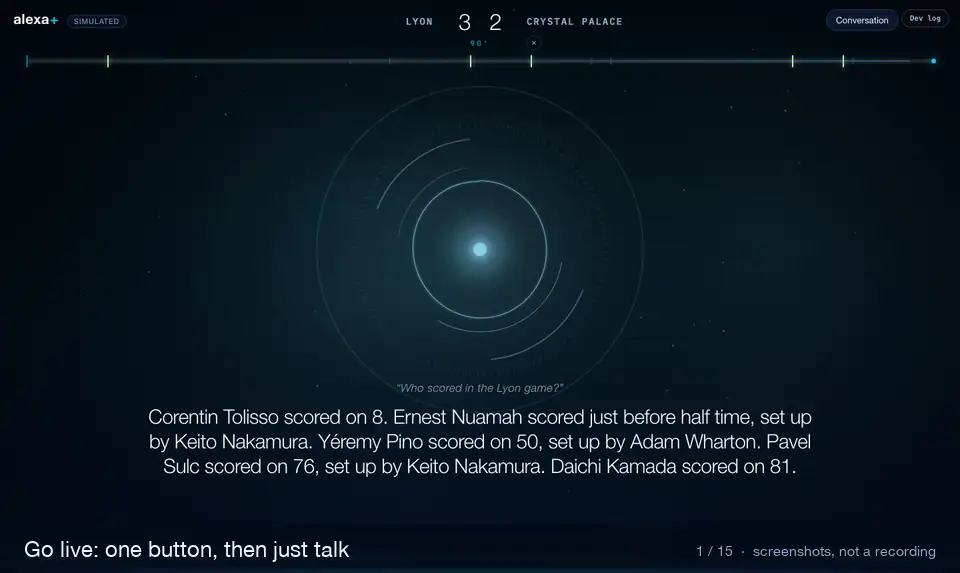
<br><sub>A 60-second loop of screenshots from a preview copy of the page, built from real results of 15 October 2026. Not a recording of a live session.</sub>
</div>

<table>
<tr>
<td width="33%">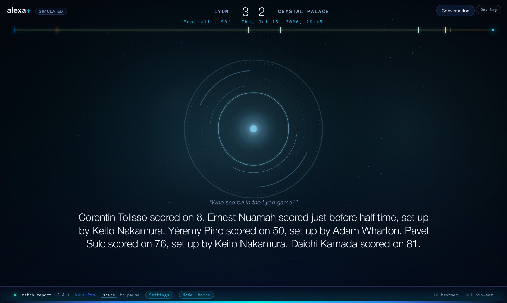<br><sub><b>A followed match</b>: score, sport, clock, date</sub></td>
<td width="33%">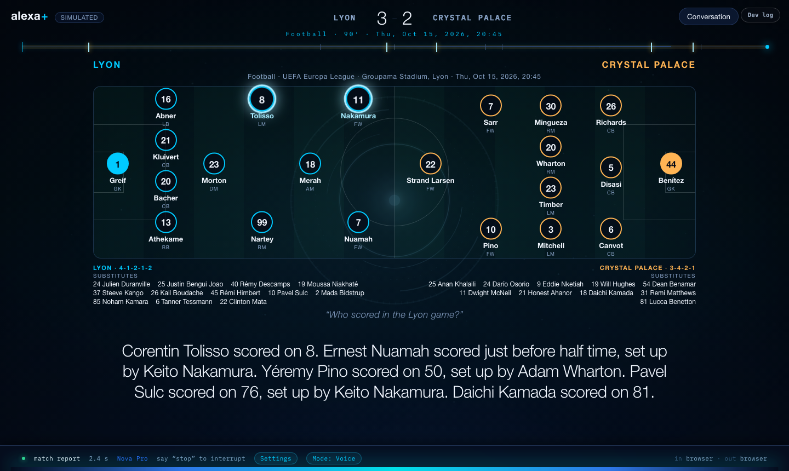<br><sub><b>Line-ups</b>: the player she names lights up</sub></td>
<td width="33%">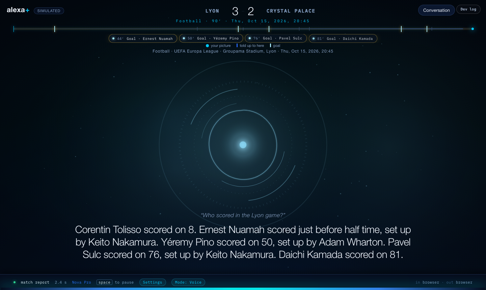<br><sub><b>The timeline</b>: goals, cards, where your picture is</sub></td>
</tr>
<tr>
<td>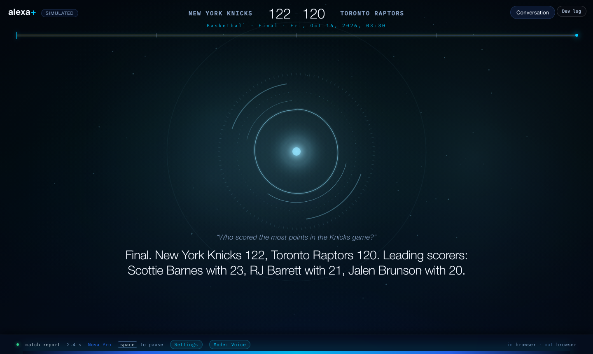<br><sub><b>Basketball</b>: quarters, not minutes</sub></td>
<td>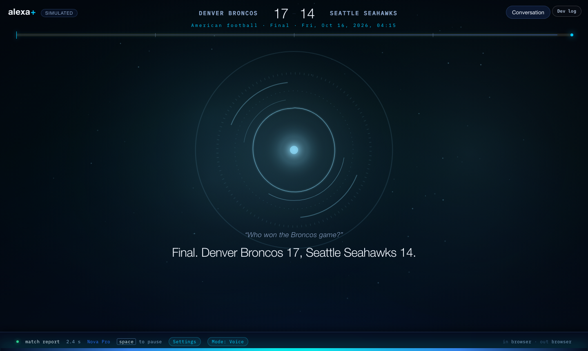<br><sub><b>American football</b>: same tools, another sport</sub></td>
<td>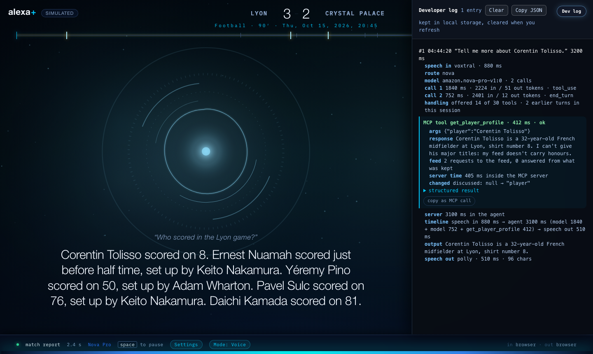<br><sub><b>The Dev log</b>: every answer traceable</sub></td>
</tr>
<tr>
<td>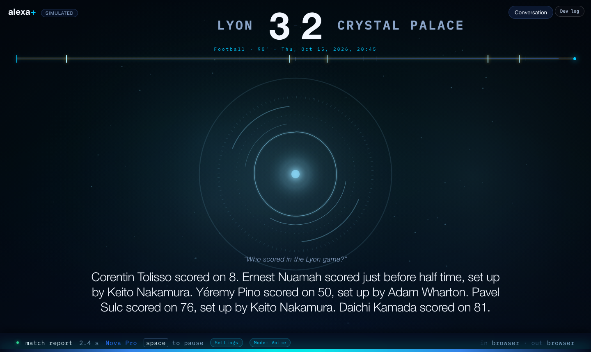<br><sub><b>Large type</b>, for low vision</sub></td>
<td>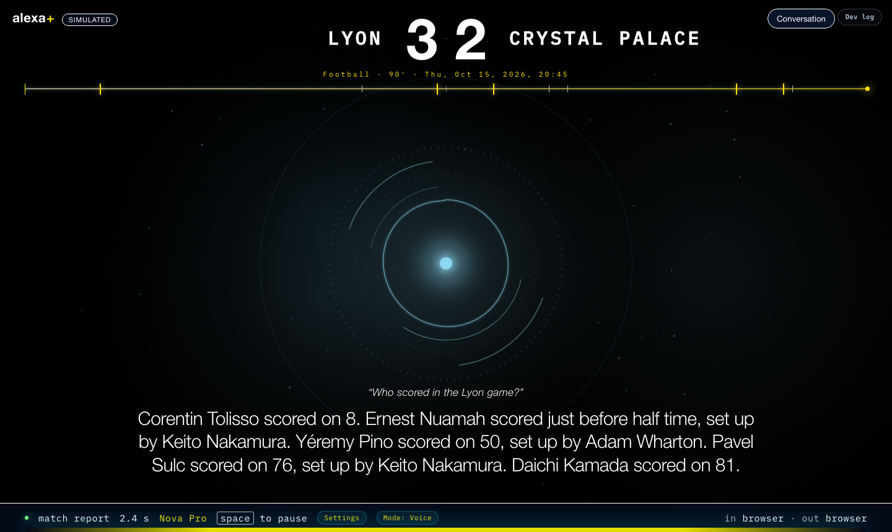<br><sub><b>High contrast</b></sub></td>
<td>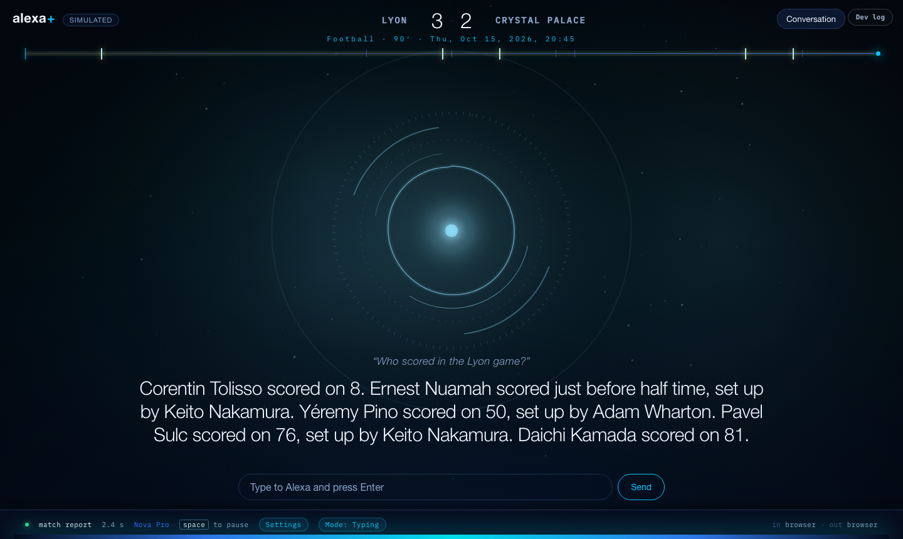<br><sub><b>Typing mode</b>: she still reads the answer</sub></td>
</tr>
</table>

The demo video (under three minutes) is linked from [docs/HACKATHON.md](docs/HACKATHON.md) once it is published.


<a name="the-potential"></a>
<a name="where-this-goes"></a>

## 🌍 The potential

Sideline answers a narrow question well: *what is happening in the match, for me, right now?* The parts that make it work
are not narrow.

<table>
<tr>
<td width="50%" valign="top">
<p><b>🎙️ Every match, as audio, for almost nothing</b><br>An audio layer built from match data, not video, costs almost nothing per match and covers every match the data covers: about 220 football competitions and four more sports today, from one public feed. For broadcasters and rights holders, that is an accessible companion for every fixture, not only the ones with a commentary team.</p>
<p><b>🧩 Any assistant, not one app</b><br>It is a standard MCP server, so the same endpoint serves Alexa+, a car, a smart speaker, a phone assistant, or any MCP client. Nothing in it is specific to the simulator.</p>
<p><b>🏟️ A new sport is a profile, not a rewrite</b><br>Five sports share 30 tools; each sport is one profile file (its clock, its scoring words, its headlines). A licensed official feed is one new provider behind the same interface.</p>
</td>
<td width="50%" valign="top">
<p><b>🧠 A pattern beyond sport</b><br>"What has changed since I last asked?" is the question behind a delivery, a flight, an election night, a market. A per-listener marker plus a held-back view of events is a reusable answer to it.</p>
<p><b>🙈 The spoiler guard, for everyone</b><br>Anyone on a delayed stream, a recording, or a different time zone wants the match without the group chat ruining it. Holding events back by the listener's own clock is built in, not bolted on.</p>
<p><b>🌐 Next: the friend who speaks first</b><br>The day an MCP host lets a server speak first, "goal!" arrives the moment it happens, still held to the listener's picture (<a href="docs/FEATURE_REQUESTS.md">FR-01</a>). The language layer can already reword the same facts in another language or register.</p>
</td>
</tr>
</table>

**The road from here.** Host it and connect a real client (the steps are [below](#connect-it-to-anything-and-host-it-later));
certified Alexa+ account linking with OAuth, which Amazon controls today; a licensed data source in place of the public
feed; sessions moved out of the process so one deployment serves many listeners; and server-initiated alerts as soon as the
platform allows them.

<a name="what-it-sounds-like"></a>

## 💬 What it sounds like

These are real answers from the live ESPN feed on 2026-10-15, about a match played the night before. They are the words
the tools return; with a model in front, they are spoken by it.

> **"What happened in the PSG game last night?"**
> Manchester City against Paris Saint-Germain, yesterday: Full time. Paris Saint-Germain 4, Manchester City 2. Désiré Doué
> scored on 13, set up by Fabián Ruiz. Ousmane Dembélé scored on 15, set up by Désiré Doué. Vitinha scored on 32 … Erling
> Haaland scored on 75, set up by Ayyoub Bouaddi. Paris Saint-Germain were awarded a penalty on 87, after Nuno Mendes was
> fouled by Matheus Nunes. Ferran Torres's penalty was saved by Gianluigi Donnarumma on 90.

> **"Tell me about the goalkeeper who saved the penalty."**
> Gianluigi Donnarumma, Manchester City goalkeeper, number 1, started. In this match: 6 saves and 4 conceded. Ferran
> Torres's penalty was saved by Gianluigi Donnarumma on 90.

> **"Tell me more about Nuno Mendes."**
> Nuno Mendes is a 24-year-old Portuguese defender at Paris Saint-Germain, shirt number 25. I can't give his major titles:
> my feed doesn't carry honours. Want his numbers this season, or how he did in the latest match?

> **"Who stood out?"**
> The standouts in Manchester City against Paris Saint-Germain, by goals, assists and shots: Erling Haaland, Manchester
> City: 2 goals and 8 shots with 3 on target. … The feed gives no player ratings, so that is what they did, not a verdict.

It says what it does not have (a referee the feed does not name, expected goals, a player's honours) instead of leaving it
out or guessing, and when something goes wrong it says an error occurred and to rephrase or try again later, never "no
matches".

<a name="what-makes-it-a-server-and-not-a-lookup"></a>

## 🧩 What makes it a server and not a lookup

**Reach.** A match is happening right now. A language model alone cannot know the score, the line-up or how many cards the
referee has shown.

**State.** The server keeps an event log of the match and, the part that matters, one marker per listener:

```
last_told_at: 12'
```

That is when we last told *this* listener anything about *this* match. When they come back after half an hour and say "what
did I miss", the request carries no time range, because Alexa+ has no idea when they last heard anything:

```json
{ "name": "what_did_i_miss", "arguments": {} }
```

No `since`. The listener gets to be terse because the server holds the state ([`sideline/state/store.py`](sideline/state/store.py)).

**The spoiler guard.** Streams run behind real time. The listener tells us what they just *heard* ("that's half time", "I
just heard a goal") and the server holds back every event their picture has not reached, by the clock: an event is spoken
once the delay after we first saw it has passed. Every tool that reads events goes through the same filter, so the match
report, the player and the officials never say what the score hides (`tests/test_critical_fixes.py`).

<a name="how-it-works"></a>

## 🏗️ How it works

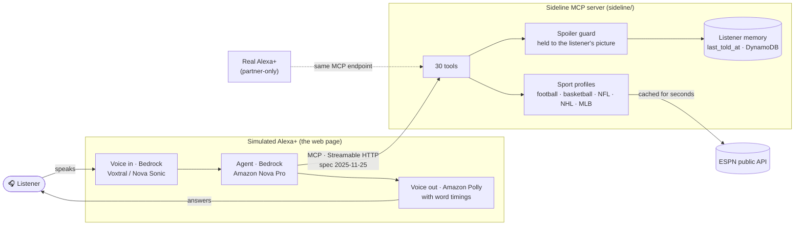

| AWS service | What it does here |
|---|---|
| **Amazon Bedrock** (a model of your choice, `SIDELINE_BEDROCK_MODEL`) | in the simulator, chooses a tool from a shortlist of the MCP catalog and words the answer; writes the spoken catch-up. Measured comparison of four models: [docs/BEDROCK.md](docs/BEDROCK.md) |
| **Bedrock, Mistral Voxtral** and **Amazon Nova 2 Sonic** | speech in: hears the listener, inside the AWS account |
| **Amazon Polly** (generative voice, neural fallback) | speech out, with word timings so the screen highlights each word as it is spoken |
| **Amazon DynamoDB** | listener state and the event log, so what a listener has heard survives a restart |

**What is the MCP, and what is around it.** The MCP is the [`sideline/`](sideline/) folder, and only that folder:
standard-library Python, no install step. Everything else supports it and can be left behind: [`simulator/`](simulator/)
plays the part of Alexa+ so the server can be tried by voice, `scripts/` holds benchmarks and checks, `tests/` the offline
suite, and `docs/` the write-ups. A test (`tests/test_standalone.py`) and a CI job copy `sideline/` alone to an empty
directory and check that it starts and serves its 30 tools there. More: [ARCHITECTURE](docs/ARCHITECTURE.md) ·
[BEDROCK](docs/BEDROCK.md) · [MCP](docs/MCP.md).

<a name="the-simulated-alexa"></a>

## 🖥️ The simulated Alexa+

The page is a wiring harness for the MCP, made to be used by ear first and by eye second.

| | |
|---|---|
| **A followed match** | A bare, full-width strip: teams, score, sport, clock in the sport's own words (34′, Q3, P2, an inning), the date and the ground; a timeline of goals and cards. It goes the moment you ask about something else, and comes back when you ask about the match. The eye turns warm while the match is live |
| **Line-ups** | "Show me the line-ups" draws a pitch: home left, away right, goalkeepers at their own ends, the benches below. The player she names lights up |
| **Live commentary** | While you follow a match in play she reads the play out every 12 s, key moments only by default, and never talks over you. "Stop commentary", "start commentary" |
| **Only your voice stops her** | A stop word ("stop", "wait") or "Alexa"; keystrokes and clicks do not. The wake word is off by default; turn it on in a shared room |
| **Voice controls on the page** | "Speak faster", "slow down", "normal speed"; "say that again"; "spell that"; "carry on" after you interrupt; "what can you do?". Tones say "I heard you" |
| **Typing mode** (Alt+T) | The microphone goes off; she still reads every answer aloud |
| **For low vision** | Large type, high contrast, captions of every word as it is spoken |
| **For developers** | The Dev log (Alt+D): what was heard, which tools ran with which arguments, timings, tokens, feed requests, "copy as MCP call". Demo mode (Alt+R) hides the controls for recording |

Details, and what has not been tried on a real device: [simulator/README.md](simulator/README.md),
[docs/ACCESSIBILITY.md](docs/ACCESSIBILITY.md), [docs/SPEECH.md](docs/SPEECH.md).

<a name="run-it"></a>

## 🛠️ Run it

### 🌐 Live Production Deployment

Sideline is deployed and running live on Render over Streamable HTTP:
* **Web Simulator Interface:** [https://sideline-1cri.onrender.com/](https://sideline-1cri.onrender.com/) (open in Chrome or Edge, click Start, and ask live questions)
* **Public MCP Server Endpoint:** `https://sideline-1cri.onrender.com/mcp`
* **Health Check:** [https://sideline-1cri.onrender.com/health](https://sideline-1cri.onrender.com/health) (`{"ok": true, "protocol": "2025-11-25", "tools": 30}`)

---

### 💻 Run it locally

| To get | You need |
|---|---|
| **The server and the live data** | Nothing: no key, no account. ESPN's public endpoints need none |
| **Answers in a model's voice, and the voice agent** | AWS credentials with Bedrock access |
| **The voice** | Polly access too. A Bedrock API key alone is not enough |
| **Durable state** | DynamoDB access and a table (`make create-table`); without it the state is kept in memory |

Python 3.8 or newer. The first launch creates an isolated `.venv` and installs `requirements.txt`; nothing is installed
system-wide.

```bash
cp .env.example .env        # then fill in your AWS credentials (the data needs none)
make env                    # what is set; never prints a secret
make run                    # starts the server on http://127.0.0.1:8765/  (or: make sim)
make test                   # the offline suite: no network, no credentials
```

Without AWS the server still starts and every tool answers in templated wording through any MCP client; the simulator's
agent needs Bedrock. The server's console prints one readable block per tool call and per agent turn
(`SIDELINE_LOG=DEBUG` adds the full result), and `logs/` keeps them as JSON lines (`make log-report` summarises them).
Settings are environment variables, documented in [docs/ENVIRONMENT.md](docs/ENVIRONMENT.md); a test keeps that page,
`.env.example` and the code in step.

Try it without a model, against the live feed:

```bash
python3 scripts/ask.py                                  # ask any tool a question, with the ESPN requests and time shown
python3 scripts/convo.py tests/conversations/batch-03-broad.json    # 50 questions, live, as one conversation
make bench                                              # what each tool costs, and the size of the tool list
make route-check                                        # does a real Bedrock model pick the right tool? (costs Bedrock calls)
```

<a name="connect-it-to-anything-and-host-it-later"></a>

## 🔌 Connect it to anything, and host it later

Sideline is a standard MCP server (spec 2025-11-25, Streamable HTTP, one endpoint: `/mcp`). Nothing in it is specific to
the simulator, so any MCP client can use it. What has been run is marked **tested**; the rest is the standard procedure,
written out, and **not yet run by us** on a real server.

<details>
<summary><b>The whole path, from this repository to a client on another machine</b> (check it locally, put it on a server, point a client at it, look after it)</summary>

#### Step 1. Check it on your machine (tested)

```bash
make run                                                        # leave it running; endpoint http://127.0.0.1:8765/mcp
curl -s localhost:8765/health                                   # {"ok": true, "tools": 30, ...}

H='-H Content-Type:application/json -H Accept:application/json,text/event-stream'
SID=$(curl -si localhost:8765/mcp $H -d '{"jsonrpc":"2.0","id":1,"method":"initialize","params":{"protocolVersion":"2025-11-25","capabilities":{},"clientInfo":{"name":"curl","version":"0"}}}' \
      | awk -F': ' 'tolower($1)=="mcp-session-id"{print $2}' | tr -d '\r')
curl -s localhost:8765/mcp $H -H "Mcp-Session-Id: $SID" -d '{"jsonrpc":"2.0","method":"notifications/initialized"}'
curl -s localhost:8765/mcp $H -H "Mcp-Session-Id: $SID" -d '{"jsonrpc":"2.0","id":2,"method":"tools/list"}'     # the 30 tools
```

A client must `initialize`, then send back the `Mcp-Session-Id` it was given on every later request. The official MCP Python
SDK has also been run against it (tested): `pip install mcp` in a throwaway virtualenv, then
`python3 scripts/check_with_sdk.py`.

#### Step 2. Put it on a server

Any machine with Python 3.8+ and a public address works. The example is a small Linux VM (for instance an EC2 instance
with Ubuntu) and a domain name you control, `sideline.example.com` below.

1. **Open the ports.** Allow inbound 80 and 443 (the security group or firewall). Do **not** open 8765: only the web server
   in front of it should reach it.
2. **Install and fetch.**
   ```bash
   sudo apt-get update && sudo apt-get install -y python3 python3-pip git
   sudo git clone https://github.com/NelsonFodjo/sideline /opt/sideline && cd /opt/sideline
   pip3 install boto3            # optional: Bedrock wording and DynamoDB state. Without it the server still works
   ```
3. **Configure it.** Make a token and put the settings in `/opt/sideline/.env`:
   ```bash
   python3 -c "import secrets; print(secrets.token_urlsafe(32))"      # copy the output
   cp .env.example .env && nano .env
   ```
   ```
   SIDELINE_HOST=127.0.0.1                     # stays on this machine; the web server in front of it is what the world reaches
   SIDELINE_AUTH_TOKEN=<the token you made>
   SIDELINE_STATE=dynamo                       # optional, see "State" below; omit to keep state in memory
   ```
   The server refuses a token shorter than 16 characters, and warns at start-up if it is reachable from outside with no token.
4. **Run it as a service** so it restarts. Create `/etc/systemd/system/sideline.service`:
   ```ini
   [Unit]
   Description=Sideline MCP server
   After=network-online.target

   [Service]
   WorkingDirectory=/opt/sideline
   ExecStart=/usr/bin/python3 -m sideline
   Restart=on-failure
   User=ubuntu

   [Install]
   WantedBy=multi-user.target
   ```
   ```bash
   sudo systemctl daemon-reload && sudo systemctl enable --now sideline
   curl -s localhost:8765/health                # {"ok": true ...}
   ```
5. **Add HTTPS.** The server speaks plain HTTP, so put a web server in front. Caddy fetches and renews the certificate itself.
   Point a DNS `A` record for `sideline.example.com` at the machine, install Caddy, and set `/etc/caddy/Caddyfile`:
   ```
   sideline.example.com {
       reverse_proxy 127.0.0.1:8765 {
           flush_interval -1          # send the event stream (GET /mcp) as it is written, not in batches
       }
   }
   ```
   then `sudo systemctl reload caddy`. (nginx or an AWS load balancer do the same job: the one thing to get right is not
   buffering responses.)
6. **Check it from your laptop**, not from the server:
   ```bash
   curl -s https://sideline.example.com/health                                           # 200, open on purpose
   curl -s -o /dev/null -w "%{http_code}\n" -X POST https://sideline.example.com/mcp      # 401: the token is required
   ```
   and repeat the Step 1 handshake against `https://sideline.example.com/mcp` with `-H "Authorization: Bearer <token>"` added.

**State (optional, recommended for a real deployment).** With `SIDELINE_STATE=dynamo` what each listener has heard survives
a restart. Run `make create-table` once with AWS credentials that may create a table. At run time the machine needs only
`dynamodb:GetItem`, `dynamodb:PutItem` and `dynamodb:Query` on that table; give an EC2 instance an IAM role with those,
not access keys in a file. For model-written wording it also needs `bedrock:InvokeModel`.

#### Step 3. Point a client at it

Every client needs the same two things: the URL `https://sideline.example.com/mcp` and the header
`Authorization: Bearer <token>`.

| Client | How |
|---|---|
| **Claude Code** (not yet run by us) | `claude mcp add --transport http sideline https://sideline.example.com/mcp --header "Authorization: Bearer <token>"` |
| **MCP Inspector** (not yet run by us) | `npx @modelcontextprotocol/inspector`; choose transport *Streamable HTTP*, enter the URL, add the `Authorization` header, connect, then *List tools* |
| **A client that takes a JSON config** | `{ "mcpServers": { "sideline": { "url": "https://sideline.example.com/mcp", "headers": { "Authorization": "Bearer <token>" } } } }` (the field names vary by client; the URL and header do not) |
| **Your own code** | Use any MCP SDK's Streamable HTTP client with that URL and header. The official Python SDK against the local server is **tested** (`scripts/check_with_sdk.py`) |
| **A client that cannot send a header** | Put an API gateway in front that adds it; or, only on a network you control, leave `SIDELINE_AUTH_TOKEN` unset |

Alexa+ itself is a separate step. It needs a public HTTPS endpoint with account linking and OAuth 2.1, which are **not built**,
and the add-on tooling is partner-only (see [docs/MCP.md](docs/MCP.md)). The bearer token is a stopgap that keeps a
deployment from being open; it is not a replacement.

#### Step 4. Look after it

| | |
|---|---|
| Logs | `journalctl -u sideline -f`, and daily files in `/opt/sideline/logs` |
| Update | `cd /opt/sideline && git pull && sudo systemctl restart sideline` |
| Health check for a load balancer | `GET /health` (open, cheap) |
| Run one copy | Sessions and the live-match poller live in the process: one instance, or sticky sessions, until they are moved out |
| One listener | State is kept per listener, taken from the `X-Sideline-Listener` header, else one shared id. Today that is **one listener per deployment**; do not give one server to several real people |
| The simulator | Not for a hosted server: the page does not send the token. Use it against a local server with no token |

#### If it does not work

| You see | Because |
|---|---|
| `401` on `/mcp` | The token is missing or wrong: send `Authorization: Bearer <token>` exactly |
| `400 Mcp-Session-Id is required` | The client skipped `initialize`, or did not send back the session id |
| `403 origin not allowed` | A browser client on another origin: add it to `SIDELINE_ALLOWED_ORIGINS` (full origin, e.g. `https://app.example.com`) |
| The client connects but hangs or never gets events | Something in front is buffering: turn buffering off for `/mcp` (`flush_interval -1` in Caddy, `proxy_buffering off` in nginx) |
| `/agent/chat` or `/voice/*` answer `404` | Normal: those belong to the simulator, which a hosted server does not need |
| The server will not start, naming `SIDELINE_AUTH_TOKEN` | It is shorter than 16 characters |

</details>

<a name="the-tools"></a>

## 🧰 The tools

Thirty, each one intent, each naming its neighbour in its description so a model does not have to guess. A tool is offered
only if the feed behind the server can answer it.

| Group | Tools |
|---|---|
| **A match you follow** | `follow_match`, `get_match_state`, `what_did_i_miss`, `get_event_detail`, `sync_broadcast_delay` |
| **A match, followed or not** | `get_match_report`, `get_match_stats`, `get_match_preview`, `get_lineups`, `get_officials`, `get_injuries`, `get_head_to_head`, `get_standouts` |
| **People** | `get_player_profile`, `get_player_stats`, `get_player_context` |
| **Teams and competitions** | `get_schedule`, `get_squad`, `get_team_stats`, `get_team_form`, `get_standings`, `get_top_scorers`, `get_fixtures`, `get_competitions`, `search` |
| **News** | `get_news` |
| **You** | `set_favourites`, `get_my_matches`, `set_preferences`, `get_capabilities` |

Contracts, and the reasoning behind each description: [docs/TOOLS.md](docs/TOOLS.md). The full tool list is about 8,000
tokens (`make bench`); the simulator's agent is offered a shortlist of it each turn (four core tools and up to four more
by keyword), and plain questions such as "what's the score?" go to one tool with no model at all.

<a name="what-has-been-verified"></a>

## ✅ What has been verified

"Verified" means it was run and the result observed; each row says how to repeat it.

| | Status |
|---|---|
| The server, tools, spoiler guard, state | **Verified**: `make test`, 68 offline suites, no network or credentials; CI runs them on Python 3.8 to 3.13 and macOS |
| Live ESPN data across five sports | **Verified**: three live conversation batches, 70 questions on real matches, in `tests/conversations/`; and 174 everyday questions asked of the whole system with every answer and verdict published, wrong ones included ([CURIOSITY_QA](docs/CURIOSITY_QA.md)) |
| One question's cost | **Measured**: the first question about a match is 3 ESPN requests and about 3 s (it was 116 and 18 s); a repeat is free |
| A model choosing among the tools | **Measured**: `scripts/route_check.py`, 79 phrasings, four Bedrock models: Amazon Nova Pro called the intended tool on **77 of 79** (97%), through the same shortlist the simulator uses. Table and caveats in [docs/BEDROCK.md](docs/BEDROCK.md) |
| Speech in | **Measured**: 48 clips, clean and noisy; Voxtral Small 0.0% and 1.4% word error, every name right ([docs/SPEECH.md](docs/SPEECH.md)) |
| Bedrock, Polly, DynamoDB | **Verified** by `make aws-check`; see [docs/BEDROCK.md](docs/BEDROCK.md) and [docs/AWS_SETUP.md](docs/AWS_SETUP.md) |
| Memory on a real DynamoDB table | **Verified** 2026-10-15 with a test listener, cleaned up afterwards: follow-ups understood; after a restart the listener still followed the match; "forget everything about me" removed the profile and marker from the table |
| Speed with DynamoDB as the state | **Measured**: a cold first follow made 26 table calls in a row (11 s); now 4.5 s for the tool and 6.3 s with the model; later questions 0 to 3 s ([FL-26](docs/FRICTION_LOG.md)) |
| A real microphone | **Reported by the team**: spoken questions, hands-free, with a real microphone. The newest voice changes (tones, speed, page-only commands) have not been tried on a real device yet |
| An independent MCP client | **Verified once** (2026-10-15): the official MCP Python SDK 2.3.0 connected, listed the 30 tools, called two tools against the live feed, and received a bad argument as a tool error (`scripts/check_with_sdk.py`). The MCP Inspector and other clients were not run |
| Alexa+ itself | **Not possible**: the add-on tooling is partner-only |

<a name="known-limitations"></a>

## ⚠️ Known limitations

We would rather you read these here than find them.

- **Hosted on Render with no OAuth.** It is deployed live as a public HTTPS endpoint at https://sideline-1cri.onrender.com/mcp
  (and can be protected with optional `SIDELINE_AUTH_TOKEN`), but full Alexa+ account linking with OAuth 2.1 is not built
  (the add-on tooling is partner-only; see [docs/MCP.md](docs/MCP.md)).
- **The data source is unofficial.** ESPN publishes no documentation or stability promise for these endpoints. We cache,
  and we say when the feed cannot be reached, but a change on their side would break things.
- **Football is the best tested.** Basketball, American football, hockey and baseball work for scores, tables, leaders and
  reports, but their match events are thinner (see [docs/ESPN_NOTES.md](docs/ESPN_NOTES.md) and the wrong answers in
  [CURIOSITY_QA](docs/CURIOSITY_QA.md)).
- **What the feed does not have, we do not say:** expected goals, player ratings, honours, half-time scores, and often the
  referee's name.
- **Routing depends on the model.** The same tools were chosen correctly far more often by some Bedrock models than by
  others ([docs/BEDROCK.md](docs/BEDROCK.md)).
- **One listener per server** by default; the state layer is keyed by listener, so the step is account linking.
- **The phone layout of the simulator is not done.** It is built for a desktop browser.

<a name="for-the-hackathon"></a>

## 🏆 For the hackathon

**Track:** Alexa+, a self-hosted MCP server (Streamable HTTP, spec 2025-11-25), demonstrated through its own simulated
Alexa+. **Mini challenge:** AWS Builder (Bedrock, Polly, DynamoDB, Voxtral, Nova Sonic).

| | |
|---|---|
| The submission text | [docs/HACKATHON.md](docs/HACKATHON.md) · [docs/DEVPOST_STORY.md](docs/DEVPOST_STORY.md) |
| The demo video script and shot list | [docs/VIDEO_SCRIPT.md](docs/VIDEO_SCRIPT.md) · [docs/VIDEO_GUIDE.pdf](docs/VIDEO_GUIDE.pdf) |
| **Friction log** (28 entries: task, steps, expected vs actual, severity, workaround, suggestion) | [docs/FRICTION_LOG.md](docs/FRICTION_LOG.md) |
| Product feedback, per tool, API and SDK | [docs/PRODUCT_FEEDBACK.md](docs/PRODUCT_FEEDBACK.md) |
| Feature requests, with priority | [docs/FEATURE_REQUESTS.md](docs/FEATURE_REQUESTS.md) |
| Every question asked of it, and what it said | [docs/CURIOSITY_QA.md](docs/CURIOSITY_QA.md) |

<a name="documentation"></a>

## 📚 Documentation

| | | |
|---|---|---|
| 🏛️ [Architecture](docs/ARCHITECTURE.md) | 🔌 [MCP](docs/MCP.md) | 🧰 [Tools](docs/TOOLS.md) |
| 🤖 [Bedrock](docs/BEDROCK.md) | 🎙️ [Speech](docs/SPEECH.md) | ♿ [Accessibility](docs/ACCESSIBILITY.md) |
| 🔎 [Finder](docs/FINDER.md) | 🏟️ [Sports](docs/SPORTS.md) | 🗄️ [Data providers](docs/DATA_PROVIDERS.md) |
| 📡 [ESPN notes](docs/ESPN_NOTES.md) | ⚙️ [Environment](docs/ENVIRONMENT.md) | ☁️ [AWS setup](docs/AWS_SETUP.md) |
| 🖥️ [Simulator](simulator/README.md) | 🎬 [Video script](docs/VIDEO_SCRIPT.md) | 🙏 [Credits](docs/CREDITS.md) |

<a name="contributing"></a>

## 🤝 Contributing

Issues and pull requests are welcome. Start with [CONTRIBUTING.md](CONTRIBUTING.md): five minutes to set up, the rules that
are not negotiable (nothing essential only on screen; every failure a sentence a person would say), and how a change gets
in. CI runs the offline suite on every pull request, starts the MCP on its own, checks the docs' links and runs CodeQL.

[Code of conduct](CODE_OF_CONDUCT.md) · [Security policy](SECURITY.md) · [Changelog](CHANGELOG.md) ·
[Open an issue](https://github.com/NelsonFodjo/sideline/issues/new/choose)

<a name="credits-and-licence"></a>

## 📄 Credits and licence

Ideas from BetTrack (cache design, whole-word name matching) and community ESPN documentation are credited, with their
licences, in [docs/CREDITS.md](docs/CREDITS.md). Released under the [MIT licence](LICENSE).

<div align="center"><sub>Built for the <i>Build, Ship, Shape</i> Amazon Developer Hackathon, October 2026.</sub></div>
